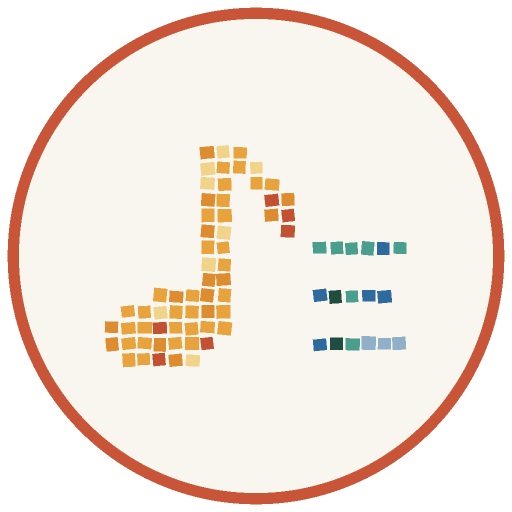

# LyricsScraperNET

[](https://www.codefactor.io/repository/github/skuill/lyricsscrapernet)
[](https://github.com/skuill/LyricsScraperNET/actions/workflows/cicd.yaml)
[](https://www.nuget.org/packages/LyricsScraperNET/)
[](https://www.nuget.org/packages/LyricsScraperNET/)
[](https://codecov.io/github/skuill/LyricsScraperNET)
[](./LICENSE)

**LyricsScraperNET** is a versatile .NET library that provides an API for searching song lyrics from various external providers. 

---

## 🌟 Features

- **Multi-framework support**: Compatible with `.NET 8`, `.NET 9`, `.NET 10`.
- **Integrated logging**: Effortless debugging and tracking.
- **Modular architecture**: Highly testable and customizable.
- **Flexible configuration**: Multiple ways to configure the library.
- **NuGet support**: Easy installation from [NuGet](https://www.nuget.org/packages/LyricsScraperNET/).

---

## 🎤 Supported Lyrics Providers

The library currently supports the following providers:

- [AZLyrics](https://www.azlyrics.com/)
- [Genius](https://genius.com/)
- [SongLyrics](https://www.songlyrics.com/)
- [LyricsFreak](https://www.lyricsfreak.com/) (added by [@ajay201402](https://github.com/ajay201402))
- [kpoplyrics](https://www.kpoplyrics.net/) (added by [@Lukeuke](https://github.com/Lukeuke))
- [LRCLIB](https://lrclib.net/)
- [Letras.mus.br](https://www.letras.mus.br/) (**Coming soon** 🚧. [Issue #40](https://github.com/skuill/LyricsScraperNET/issues/40))
- [darklyrics](http://www.darklyrics.com/) (**Coming soon** 🚧. [Issue #41](https://github.com/skuill/LyricsScraperNET/issues/41))
- [vagalume](https://www.vagalume.com.br/) (**Coming soon** 🚧. [Issue #42](https://github.com/skuill/LyricsScraperNET/issues/42))
- [Lyrics](https://www.lyrics.com/) (**Coming soon** 🚧. [Issue #25](https://github.com/skuill/LyricsScraperNET/issues/25))

Provider details (how each one searches, Genius matching rules) and the removed providers (Musixmatch, LyricFind) are described in [docs/providers.md](docs/providers.md).

Upgrading from 2.x: see [docs/migration-2.x-to-3.0.md](docs/migration-2.x-to-3.0.md).

---

## 📋 Getting Started

Here’s a simple example to demonstrate how to initialize and use the library with all available providers:

```csharp
using LyricsScraperNET;
using LyricsScraperNET.Models.Requests;

class Program
{
    static async Task Main()
    {
        // Create an instance of LyricScraperClient with all providers
        ILyricsScraperClient lyricsScraperClient = new LyricsScraperClient()
            .WithAllProviders();

        var searchRequest = new ArtistAndSongSearchRequest(
            artist: "Metallica", 
            song: "Nothing Else Matters"
        );

        var searchResult = await lyricsScraperClient.SearchLyricAsync(searchRequest);

        if (!searchResult.IsEmpty())
        {
            Console.WriteLine(searchResult.LyricText);
        }
    }
}
```

More examples are in the [LyricsScraperNET.Client](LyricsScraperNET.Client/Program.cs) project.

---

## 📚 Documentation

| Topic | Document |
|---|---|
| Client and provider settings, search order, `appsettings.json` (with or without dependency injection), result codes | [docs/configuration.md](docs/configuration.md) |
| Dependency injection (`IServiceCollection`, `IConfiguration`) | [docs/dependency-injection.md](docs/dependency-injection.md) |
| HTTP: own `HttpClient`, User-Agent, proxy, Genius API key | [docs/http.md](docs/http.md) |
| Providers: how they search, known limits, removed providers | [docs/providers.md](docs/providers.md) |
| Architecture, search flow, adding a provider | [docs/architecture.md](docs/architecture.md) |
| Upgrading from 2.x to 3.0 | [docs/migration-2.x-to-3.0.md](docs/migration-2.x-to-3.0.md) |
| Obsolete members and their diagnostic ids (`LSNET0001`, ...) | [docs/obsoletions/README.md](docs/obsoletions/README.md) |

---

## 🛠️ Installation

Install the package from NuGet:

```sh
dotnet add package LyricsScraperNET
```

---

## ⚖️ Responsible Use

- LyricsScraperNET does not host, store or redistribute lyrics. It requests them from the providers on behalf of the application that uses it.
- Lyrics are protected by copyright of their authors and publishers. You are responsible for following the terms of use of each provider and the copyright law that applies to you, especially if you show lyrics publicly or use them commercially.
- The library does not bypass bot protection, captchas or other access restrictions. A provider whose site blocks automated access is removed (see [removed providers](docs/providers.md#removed-providers)).

### Provider removal requests

If you own or represent a site used by one of the providers and want it removed from the library, open an [issue](https://github.com/skuill/LyricsScraperNET/issues/new) or contact the maintainer through the channels listed on the [GitHub profile](https://github.com/skuill). The provider will be removed promptly.

---

## 🖋️ Contributing and Feedback

Contributions are welcome! 

- Fork the repository and create a [Pull Request](https://github.com/skuill/LyricScraperNET/pulls).
- Report issues or propose features via the [Issues](https://github.com/skuill/LyricScraperNET/issues/new) tab.

For direct feedback, feel free to reach out on [Telegram](https://t.me/skuill).

---

## 💖 Support

If you find this project helpful, consider supporting it:

- Starring this repository on [GitHub](https://github.com/skuill/LyricsScraperNET/stargazers) ⭐.
- [](https://www.buymeacoffee.com/skuill)  
- [](https://www.tinkoff.ru/cf/3MNYeRds3s)

Your support helps keep this project alive and evolving!

---

## 📜 License

This project is licensed under the [MIT License](./LICENSE).
